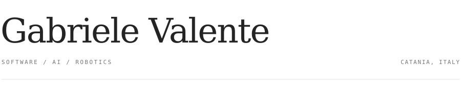

<picture>
  <source media="(prefers-color-scheme: dark)" srcset="assets/header-dark.svg" />
  <source media="(prefers-color-scheme: light)" srcset="assets/header-light.svg" />
  
</picture>

 

I build software that connects **intelligence and the physical world**.

Developer at **Software Engineering Italia**. Student at the **University of Catania**.

[LinkedIn](https://www.linkedin.com/in/gabriele-valente2007/) &nbsp; / &nbsp; [Portfolio](https://www.neova.it/) &nbsp; / &nbsp; [Email](mailto:gabrielevalente2007@icloud.com)

 

### Selected work

[**SmartGraph**](https://github.com/gabriiivale007/SmartGraph) — graphs, mazes and pathfinding in Python.

[**RoboCup Junior Europe 2025**](https://www.ilgiornale.it/news/attualit/robotica-l-iis-e-fermi-r-guttuso-giarre-conquista-l-europa-2493672.html) — 3rd place in Rescue Maze with team MezaMaze.

Python &nbsp; · &nbsp; React &nbsp; · &nbsp; LLMs &nbsp; · &nbsp; ESP32 &nbsp; · &nbsp; Unity

  

<picture>
  <source media="(prefers-color-scheme: dark)" srcset="https://raw.githubusercontent.com/gabriiivale007/gabriiivale007/output/snake-dark.svg" />
  <source media="(prefers-color-scheme: light)" srcset="https://raw.githubusercontent.com/gabriiivale007/gabriiivale007/output/snake.svg" />
  
</picture>
